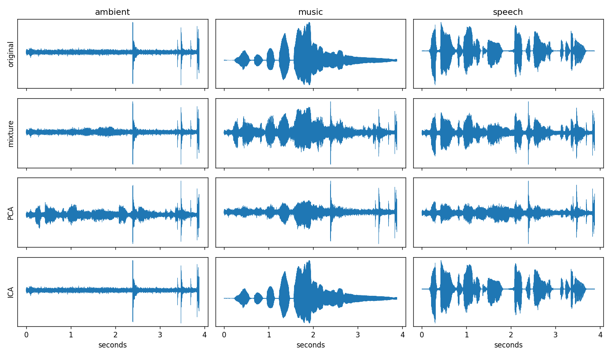

# Write-up

## What I did

1. Took three clean clips: speech, music, ambient noise.
2. Mixed them into three signals with this matrix (each row is one "microphone"):

```
0.65  0.25  0.10
0.20  0.60  0.35
0.30  0.15  0.75
```

3. Centered the mixtures (subtract the mean).
4. Whitened them: eigendecomposition of the covariance matrix, then rotate and rescale so the signals are uncorrelated with unit variance.
5. Ran FastICA (symmetric, tanh nonlinearity) on the whitened signals.
6. Saved the outputs as wavs and compared them to the originals.

## Results

```
source      PCA corr   PCA SDR  ICA corr   ICA SDR
ambient        0.636      -1.7     1.000      38.8
music          0.831       3.5     1.000      45.7
speech         0.663      -1.0     1.000      49.1
```



In the plot, the PCA row still looks like a blend of the sources. The ICA row looks like the originals.

## Why these metrics

ICA can't know the original order or volume of the sources, so a plain comparison would be unfair.

- Order: I match each true source to the output it correlates with most (Hungarian matching on absolute correlation).
- Volume and sign: I use scale-invariant SDR (SI-SDR). It rescales the output to best fit the source before measuring the error, and a flipped sign doesn't matter.
- I also report absolute correlation because it is easy to read. 1.0 is a perfect match.

## Short explanations

**Why ICA and not PCA?** PCA only makes the outputs uncorrelated, which uses second-order statistics (the covariance). Many different rotations of the data are uncorrelated, so PCA can't tell which one is the true sources. ICA asks for independence, which needs higher-order statistics, and that picks out the right rotation.

**What does whitening do?** It makes the data uncorrelated with unit variance. After that, the only thing left to find is a rotation, instead of a full general matrix. That makes ICA a much smaller problem, and it lets us keep the unmixing matrix orthogonal.

**Why does non-Gaussianity help?** A mix of independent signals looks more Gaussian than the signals themselves (the Central Limit Theorem). So ICA looks for the directions that look as non-Gaussian as possible, because those are the original sources. The kurtosis numbers show this: the mixtures have lower kurtosis than the sources (45, 4.1, 4.5 vs 62, 8.6, 5.1), and ICA brings it back. If sources were Gaussian, separation would be impossible.

**Known limits.** ICA can't recover the order, sign or loudness of the sources. The mixing here is instant and noise-free, which is the easy case. Real room recordings have delays and echoes, which plain ICA doesn't handle.

## Not done

The bonus items (real multi-device recordings, SNR sweep, mini-Shazam) are left out to keep this a minimal demo. PCA vs ICA is covered above.
